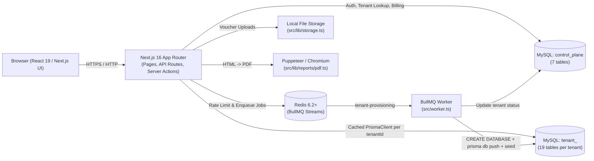
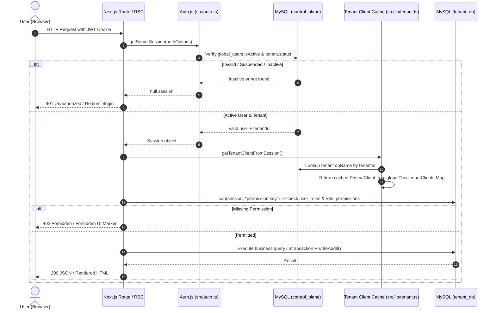

# 02. System Architecture

**Purpose:** Explains LandInvest's multi-tenant architecture, request lifecycle, database client caching, and codebase layering.  
**Intended Reader:** Technical Lead, Backend Developer, Architect.  
**Last Verified:** 2026-11-12

---

## High-Level System Architecture

---

## Multi-Tenant Design: Database-Per-Tenant

LandInvest uses a **hybrid control-plane + database-per-tenant** model:
- **`control_plane` (1 shared database):** Stores registered tenants (`tenants`), user login credentials (`global_users`), invitations, password resets, subscription plans, and billing invoices.
- **`tenant_*` (1 database per customer):** Stores all operational ERP data (partners, projects, plots, expenses, sales, ledgers, roles, audit logs).

### Why This Was Chosen (`Inferred reason:`)
- **Hard Data Isolation:** A bug in a SQL `WHERE` clause cannot leak one syndicate's financial data to another customer because their data lives in separate MySQL schemas.
- **Per-Customer Backup & Export:** An individual tenant database can be backed up, restored, or offboarded without touching other tenants.

### Trade-Offs
- **Migrations Across Tenants:** Any change to `prisma/tenant/schema.prisma` must be pushed to *every* active tenant database.
- **Connection Management:** Each active tenant requires its own `PrismaClient` connection pool.

---

## Request Lifecycle (Sequence)

---

## Tenant Database Client Caching & Connection Limits

Implemented in [`src/lib/tenant.ts`](../src/lib/tenant.ts):
- `globalThis.tenantClients` holds a `Map<string, PrismaClient>` keyed by `tenant.id`.
- `getTenantClient(tenant)` checks `globalForTenant.tenantClients.get(tenant.id)` (and verifies `(cached as any).dashboardLayout` exists to handle hot-reload schema updates in dev) before instantiating a new `PrismaClient` with `mysql://${tenant.dbUser}:@localhost:3306/${tenant.dbName}`.
- **Note on Connection Limits:** No explicit `connection_limit` query parameter or LRU eviction is currently set on `globalThis.tenantClients` (noted in `19-known-issues-and-roadmap.md`).

---

## Folder & Layer Overview

| Layer | Location | Responsibility |
|---|---|---|
| **App Router UI & Pages** | `src/app/**/page.tsx` | Server Components (auth/RBAC checks + initial data fetch) and `*Client.tsx` interactive views. |
| **API Routes** | `src/app/api/**/route.ts` | REST/JSON & file-upload/PDF/Excel endpoints. |
| **Core Domain & Rules** | `src/lib/` | `tenantRules.ts`, `collections.ts`, `treasury.ts`, `fiscalYear.ts`, `rbac.ts`, `permissions.ts`, `format.ts`, `area.ts`. |
| **Reports & Dashboard** | `src/lib/reports/`, `src/lib/dashboard/` | 26 report query modules + PDF/Excel builders + widget registry. |
| **Background Worker** | `src/worker.ts` | BullMQ worker for `tenant-provisioning`. |
| **Database Schemas** | `prisma/control/schema.prisma`, `prisma/tenant/schema.prisma` | Separate Prisma schemas & generated clients (`src/generated/control`, `src/generated/tenant`). |
| **Scripts & Tests** | `scripts/` | Setup, seeding, acceptance (`acceptance.mjs`), Fiscal Year TDD (`test_fiscal_years.mjs`), Full E2E (`test_full_project.mjs`). |
`;
