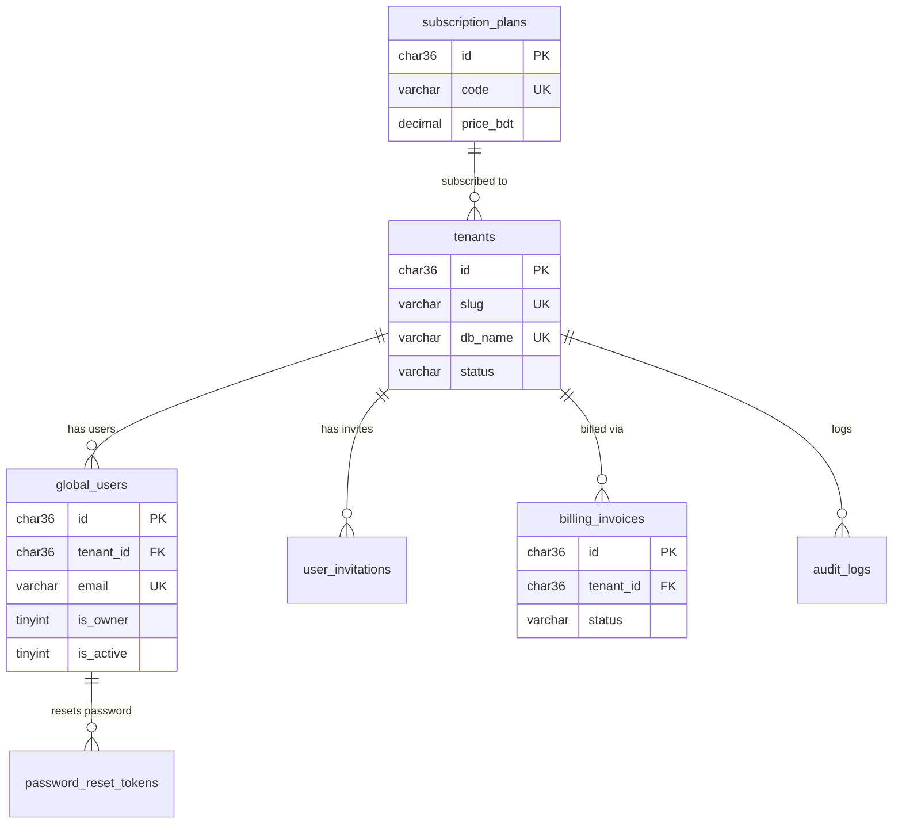
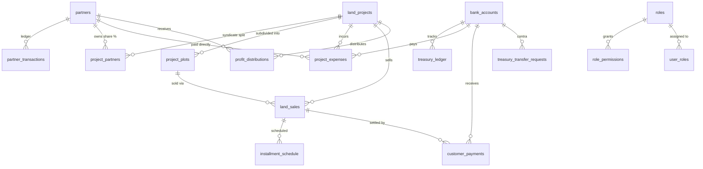
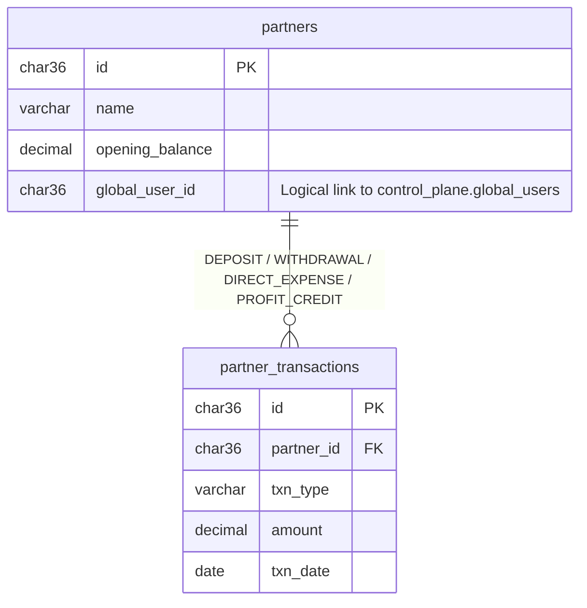
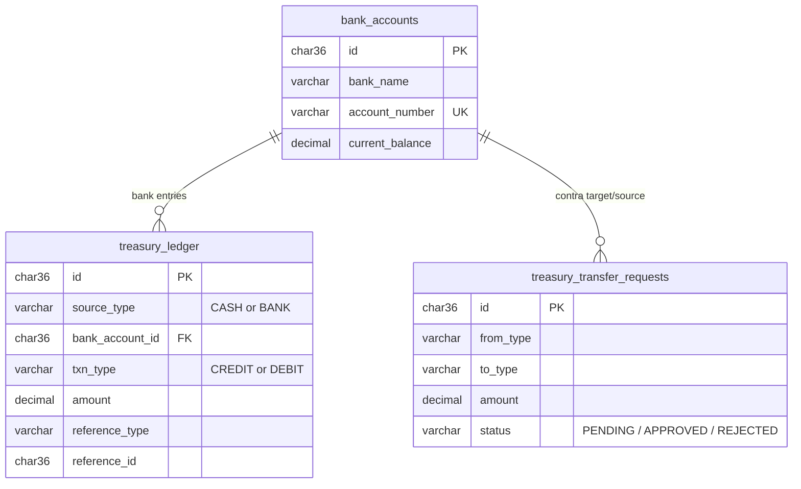
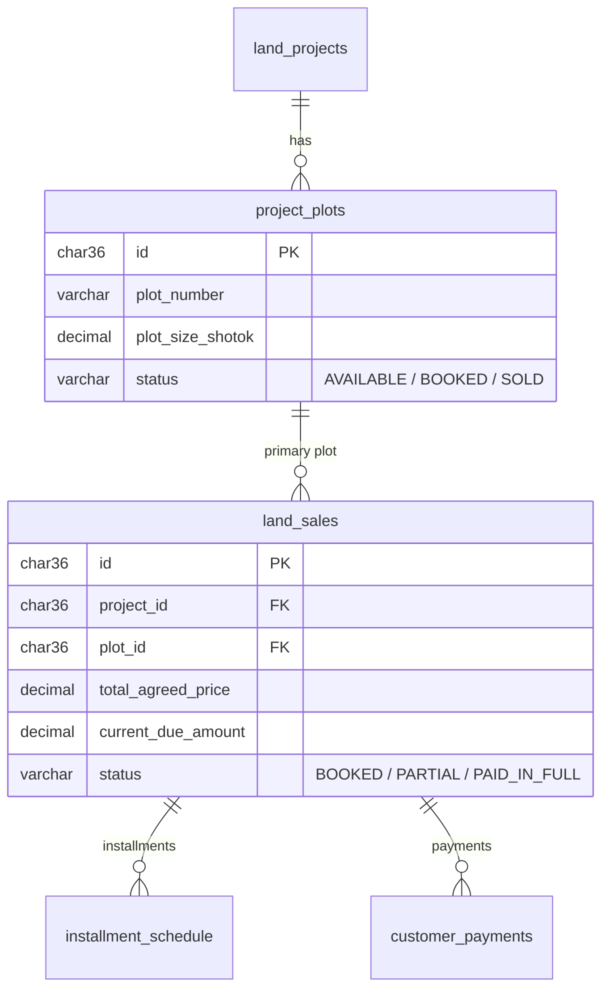
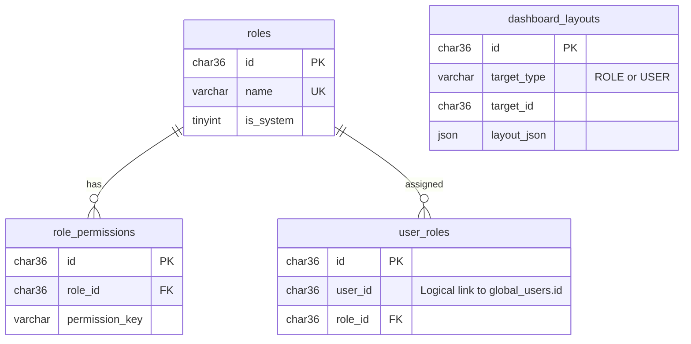

# 04d. Entity Relationship Diagrams (ERD)

**Purpose:** Visual Mermaid ERDs for `control_plane`, the full `tenant_*` database, and each functional module.  
**Intended Reader:** Technical Lead, Database Administrator, Backend Developer.  
**Last Verified:** 2026-11-12

---

## 1. Control Plane ERD (\`control_plane\`)

---

## 2. Full Tenant Database Overview ERD (\`tenant_*\`)

---

## 3. Module ERDs

### Partners & Capital

### Treasury (Cash & Bank)

### Plots, Sales & Collections

### RBAC & Dashboard

`;
writeDoc("04-database/04d-erd.md", ...)`
