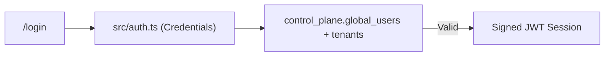

# Module 01: Auth & Tenant Management

**Last Verified:** 2026-11-12

1. **Purpose:** Authenticates users, manages password resets and forced password changes, and provisions isolated tenant databases on signup.
2. **Who Uses It:** All users (`/login`, `/change-password`, `/forgot-password`, `/reset-password/[token]`); prospective owners (`/signup`).
3. **Screens & Routes:** `/login`, `/signup`, `/forgot-password`, `/reset-password/[token]`, `/change-password`, `/invite/[token]`.
4. **Main Workflow:**

5. **Data (Tables Read & Written):** Reads/Writes `control_plane.tenants`, `control_plane.global_users`, `control_plane.password_reset_tokens`, `control_plane.user_invitations`.
6. **Business Rules:** Active check on every session callback (`src/auth.ts`); suspended/cancelled tenants blocked; rate limiting (`AUTH_RATE_LIMIT_MAX`).
7. **Calculations:** N/A (bcrypt cost factor hashing & token expiry timestamps).
8. **Integrations:** Provides `tenantId`, `user_id`, and `isOwner` to `src/lib/tenant.ts` and `src/lib/rbac.ts`.
9. **Code Map:** `src/auth.ts`, `src/app/login/page.tsx`, `src/app/signup/page.tsx`, `src/app/api/signup/route.ts`, `src/app/api/auth/*`, `src/worker.ts`.
10. **Edge Cases & Validations:** Deactivated users or suspended tenants are rejected on the next session check even if their JWT has not expired.
11. **Known Limitations:** Email delivery for password resets/invites is not wired to an external SMTP provider by default.
