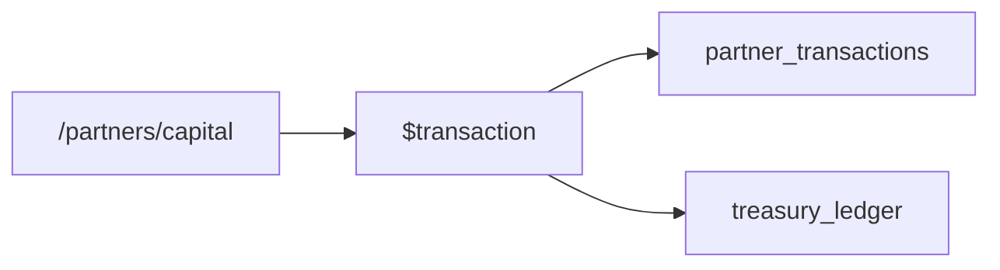

# Module 02: Partners & Capital

**Last Verified:** 2026-11-12

1. **Purpose:** Tracks syndicate investors, opening equity, capital deposits, withdrawals, direct project expenses, and profit credits.
2. **Who Uses It:** Owner, Managing Partner (`partners.view`, `partners.manage`, `partners.capital.deposit`, `partners.capital.withdraw`, `partners.ledger.view`).
3. **Screens & Routes:** `/partners` (directory), `/partners/dashboard`, `/partners/capital` (deposits & withdrawals).
4. **Main Workflow:**

5. **Data (Tables Read & Written):** Reads/Writes `partners`, `partner_transactions`, `treasury_ledger`, `bank_accounts`, `audit_log`.
6. **Business Rules:** Partner capital deposits/withdrawals must update `treasury_ledger` (and `bank_accounts` if BANK) atomically with `audit_log` (`BR-10`, `BR-11`).
7. **Calculations:** **Worked Example:** Opening `৳ 50,00,000` + Deposit `৳ 10,00,000` + Profit Credit `৳ 4,50,000` - Direct Expense `৳ 50,000` - Withdrawal `৳ 2,00,000` = Net Capital `৳ 62,00,000`.
8. **Integrations:** Feeds `project_partners` share splits, `project_expenses` (`PAID_BY_PARTNER`), `profit_distributions`, and Partner reports.
9. **Code Map:** `src/app/partners/**`, `src/app/api/partners/route.ts`, `src/lib/reports/partner-*.ts`.
10. **Edge Cases & Validations:** Opening balance must be included alongside `partner_transactions` when computing total partner net position.
11. **Known Limitations:** `POST` mutations use Server Actions rather than `/api/partners` (which is GET-only).
