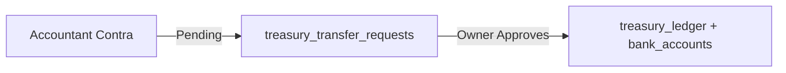

# Module 03: Cash & Bank Ledger (Treasury)

**Last Verified:** 2026-11-12

1. **Purpose:** Maintains real-time Cash-in-Hand and Bank account balances through an immutable CREDIT/DEBIT ledger and approved contra transfers.
2. **Who Uses It:** Owner, Managing Partner, Accountant (`treasury.view`, `treasury.bank.manage`, `treasury.contra.create`, `treasury.contra.approve`).
3. **Screens & Routes:** `/treasury`, `/treasury/dashboard`, `/treasury/accounts`, `/treasury/transactions`, `/treasury/approvals`.
4. **Main Workflow:**

5. **Data (Tables Read & Written):** Reads/Writes `bank_accounts`, `treasury_ledger`, `treasury_transfer_requests`, `audit_log`.
6. **Business Rules:** Non-approvers queue contra transfers as `PENDING`; approvers post paired `DEBIT` and `CREDIT` rows (`BR-13`). `PAID_BY_PARTNER` never writes `treasury_ledger` (`BR-01`).
7. **Calculations:** **Worked Example:** Cash Opening `৳ 5,00,000` + Sale Advance `৳ 3,00,000` - Contra to Bank `৳ 2,00,000` = Cash Balance `৳ 6,00,000`; Bank increases by `+৳ 2,00,000`.
8. **Integrations:** Receives debits from approved `CASH`/`BANK` expenses and credits from `customer_payments` and partner deposits.
9. **Code Map:** `src/lib/treasury.ts`, `src/app/treasury/**`, `src/app/api/banks/route.ts`, `src/app/api/treasury/contra/**`.
10. **Edge Cases & Validations:** Contra transfers requiring a bank account validate `bankAccountId` exists and is active.
11. **Known Limitations:** Bank reconciliation against external bank CSV statements is not yet automated.
