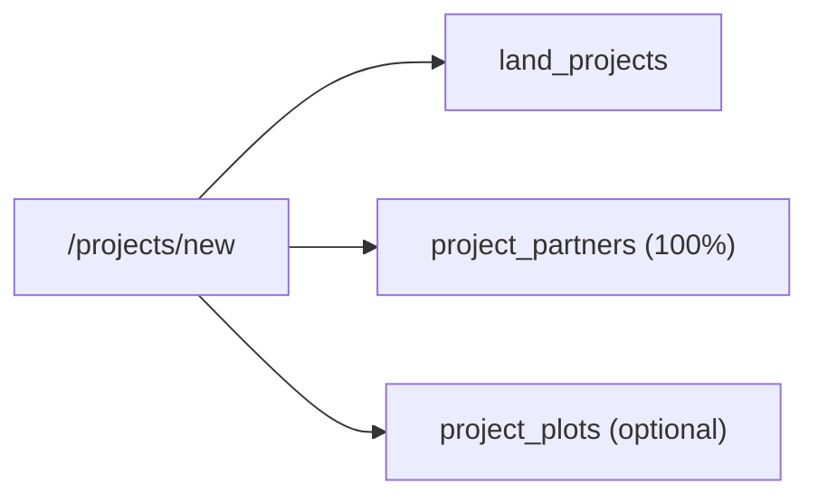

# Module 04: Land & Acquisition

**Last Verified:** 2026-11-12

1. **Purpose:** Manages land development projects, Bangladeshi deed metadata (Mouza, JL, Dag, Khatian), and partner ownership percentages.
2. **Who Uses It:** Owner, Managing Partner, Site Manager (`projects.view`, `projects.create`, `projects.edit`, `projects.delete`).
3. **Screens & Routes:** `/projects`, `/projects/new` (acquisition wizard), `/projects/[id]`.
4. **Main Workflow:**

5. **Data (Tables Read & Written):** Reads/Writes `land_projects`, `project_partners`, `project_plots`, `audit_log`.
6. **Business Rules:** Partner `share_percent` per project must sum to 100% (`BR-03`). Area stored in Shotok (`BR-12`).
7. **Calculations:** **Worked Example:** Acquired `66 Shotok` (`2 Bigha` / `40 Katha`). Partner A (`60%`) + Partner B (`40%`) = `100%`.
8. **Integrations:** Parent entity for `project_plots`, `project_expenses`, `land_sales`, and `profit_distributions`.
9. **Code Map:** `src/app/projects/**`, `src/app/api/projects/route.ts`, `src/lib/area.ts`.
10. **Edge Cases & Validations:** Land acquisition costs (Bayna, Registration) are recorded as `project_expenses` linked to `project_id`.
11. **Known Limitations:** Project-level document file attachments (scanned deeds) are limited compared to expense vouchers.
