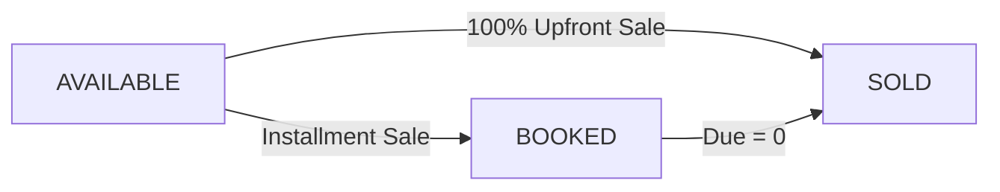

# Module 05: Plots & Inventory

**Last Verified:** 2026-11-12

1. **Purpose:** Subdivides acquired project land into saleable plots, tracks Shotok size and asking price, and locks sold/booked inventory.
2. **Who Uses It:** Owner, Managing Partner, Site Manager (`plots.manage`, `projects.view`).
3. **Screens & Routes:** `/projects/plots`, `/projects/[id]`.
4. **Main Workflow:**

5. **Data (Tables Read & Written):** Reads/Writes `project_plots`, `land_projects`, `audit_log`.
6. **Business Rules:** Total subdivided plot Shotok cannot exceed project saleable area (`BR-04`); only `AVAILABLE` plots can be booked/sold (`BR-05`).
7. **Calculations:** **Worked Example:** `5.00 Shotok` plot @ `৳ 2,50,000/Shotok` = Asking Price `৳ 12,50,000.00` (`≈ 3.03 Katha`).
8. **Integrations:** Consumed by `POST /api/sales` (single, multi-plot, whole-project) and `plot-inventory` report.
9. **Code Map:** `src/app/projects/plots/page.tsx`, `src/lib/tenantRules.ts` (`sellPlot`), `src/lib/area.ts`.
10. **Edge Cases & Validations:** Multi-plot sales store the first plot in `land_sales.plot_id` while updating all selected plots in `project_plots`.
11. **Known Limitations:** Automated plot-hold expiry timer is not yet scheduled in `src/worker.ts`.
