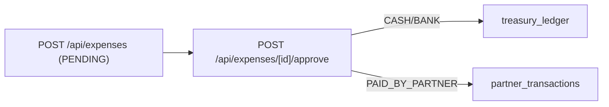

# Module 06: Project Expenses

**Last Verified:** 2026-11-12

1. **Purpose:** Captures project acquisition, legal, development, and overhead expenses with approval workflow and 3 payment channels.
2. **Who Uses It:** Site Manager, Accountant, Managing Partner, Owner (`expenses.view`, `expenses.create`, `expenses.approve`, `expenses.delete`).
3. **Screens & Routes:** `/expenses`, `/expenses/dashboard`, `/expenses/approvals`, `/expenses/breakdown`.
4. **Main Workflow:**

5. **Data (Tables Read & Written):** Reads/Writes `project_expenses`, `treasury_ledger`, `bank_accounts`, `partner_transactions`, `audit_log`.
6. **Business Rules:** `PAID_BY_PARTNER` never touches `treasury_ledger` (`BR-01`); only `APPROVED` expenses count in PnL (`BR-02`). Validates category, positive amount, and channel requirements.
7. **Calculations:** **Worked Example:** `৳ 85,000` (`DEVELOPMENT`, `CASH`) approved -> `project_expenses.status = APPROVED`, `treasury_ledger` debited `৳ 85,000`.
8. **Integrations:** Linked to `vouchers` UI, `treasury_ledger`, `partner_transactions`, `project-cost`, and `project-pnl`.
9. **Code Map:** `src/app/expenses/**`, `src/app/api/expenses/route.ts`, `src/app/api/expenses/[id]/approve/route.ts`.
10. **Edge Cases & Validations:** Supports both snake_case and camelCase FormData keys and returns `400` JSON on invalid/missing fields.
11. **Known Limitations:** Uploaded voucher files are saved locally without strict MIME allowlist checks.
