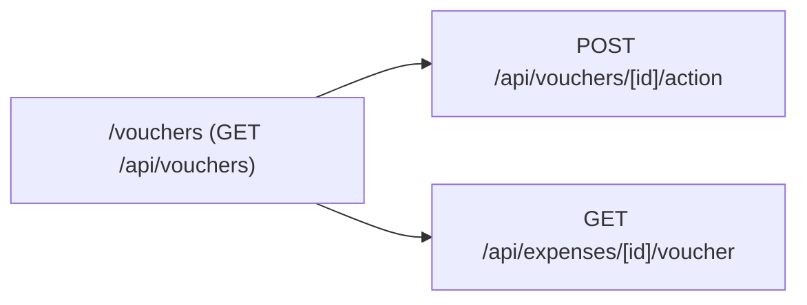

# Module 07: Voucher Management

**Last Verified:** 2026-11-12

1. **Purpose:** Provides centralized voucher listing, approval actions, and printable voucher retrieval for expenses.
2. **Who Uses It:** Accountant, Managing Partner, Owner (`expenses.view`, `expenses.approve`).
3. **Screens & Routes:** `/vouchers`.
4. **Main Workflow:**

5. **Data (Tables Read & Written):** Reads/Writes `project_expenses`, `audit_log` (and treasury/partner ledgers on approval).
6. **Business Rules:** Voucher approvals follow the same `BR-01` and `BR-02` rules as `/expenses/approvals`.
7. **Calculations:** N/A (delegates ledger math to expense approval).
8. **Integrations:** Backed by `project_expenses` and `src/lib/storage.ts` for attached receipt images.
9. **Code Map:** `src/app/vouchers/page.tsx`, `src/app/api/vouchers/**`, `src/app/api/expenses/[id]/voucher/route.ts`.
10. **Edge Cases & Validations:** Expenses without an uploaded voucher image still generate a printable system voucher.
11. **Known Limitations:** Bulk multi-voucher approval in one click is not implemented.
