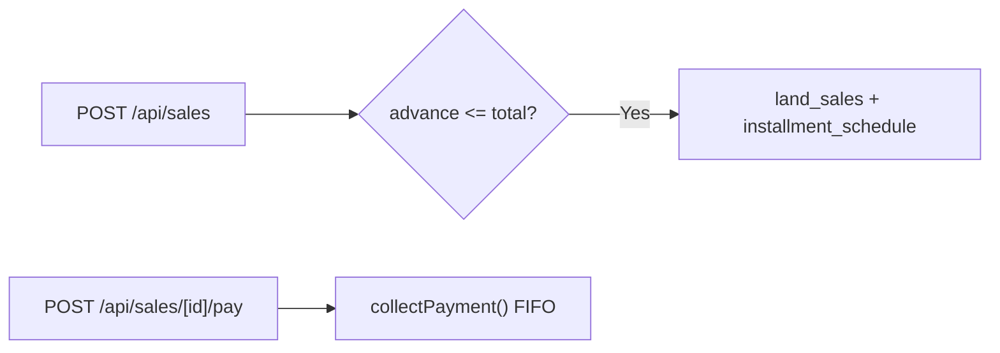

# Module 08: Plot Sales & Dues

**Last Verified:** 2026-11-12

1. **Purpose:** Handles single-plot, multi-plot, and whole-project sales, installment schedules, FIFO collections, overpayment guards, and money receipts.
2. **Who Uses It:** Owner, Managing Partner, Accountant (`sales.view`, `sales.create`, `sales.collect`, `receipts.print`).
3. **Screens & Routes:** `/sales`, `/sales/bookings`, `/sales/dues`, `/sales/[id]`.
4. **Main Workflow:**

5. **Data (Tables Read & Written):** Reads/Writes `land_sales`, `project_plots`, `installment_schedule`, `customer_payments`, `treasury_ledger`, `bank_accounts`, `audit_log`.
6. **Business Rules:** Advance <= total price (`BR-06`), payment <= `currentDueAmount` (`BR-07`), FIFO installment settlement (`BR-08`), full payment sets `PAID_IN_FULL` & `SOLD` (`BR-09`).
7. **Calculations:** **Worked Example:** Price `৳ 12,00,000`, Advance `৳ 2,00,000`, 4 installments -> `current_due_amount = ৳ 10,00,000` (`৳ 2,50,000` each). Paying `৳ 2,50,000` settles Installment #1 (`PAID`) and lowers due to `৳ 7,50,000`.
8. **Integrations:** Credits `treasury_ledger` / `bank_accounts` and feeds Sales/Collection/Receivables reports.
9. **Code Map:** `src/app/sales/**`, `src/app/api/sales/**`, `src/lib/collections.ts`, `src/lib/tenantRules.ts`.
10. **Edge Cases & Validations:** Bank/Cheque/MFS advance payments validate that a valid `bank_account` is selected.
11. **Known Limitations:** Multi-plot sales link `land_sales.plot_id` to the first plot; individual secondary plot IDs are tracked via `project_plots.status` & `audit_log`.
