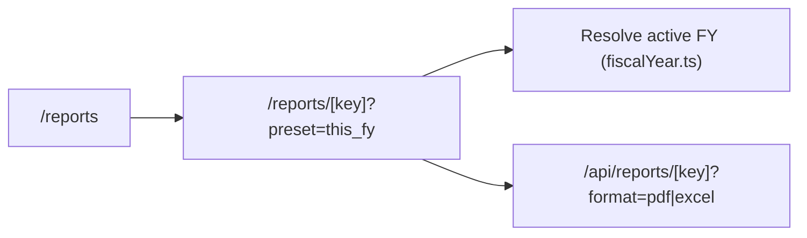

# Module 09: Reports & Profit Distribution

**Last Verified:** 2026-11-12

1. **Purpose:** Provides 26 financial, partner, project, sales, profit, and audit reports with Grid/List catalog views, Fiscal Year filtering, and PDF/Excel export.
2. **Who Uses It:** Role-gated per category (`reports.view`, `reports.export`, `reports.*.view`, `profit.distribute`).
3. **Screens & Routes:** `/reports` (catalog with category filters & Grid/List toggle), `/reports/[key]`, `/reports/project-pnl`.
4. **Main Workflow:**

5. **Data (Tables Read & Written):** Reads all financial/operational tables; writes `profit_distributions`, `partner_transactions`, `audit_log` on profit distribution.
6. **Business Rules:** Only `APPROVED` expenses count (`BR-02`); `this_fy` uses tenant's active FY from `dashboard_settings` when custom dates aren't passed.
7. **Calculations:** **Worked Example:** Revenue `৳ 50,00,000` - Approved Expenses `৳ 35,00,000` = Net Profit `৳ 15,00,000`. Partner (60%) = `৳ 9,00,000`; Partner (40%) = `৳ 6,00,000`.
8. **Integrations:** Shares query logic with Dashboard widgets; exports via Puppeteer (`pdf.ts`) and Excel HTML (`excel.ts`).
9. **Code Map:** `src/app/reports/**`, `src/components/reports/**`, `src/lib/reports/**`, `src/app/api/reports/**`.
10. **Edge Cases & Validations:** Switching preset in `ReportFilters.tsx` omits stale `from`/`to` dates unless `custom` is selected.
11. **Known Limitations:** PDF export requires Chromium via Puppeteer; falls back to HTML if Chromium fails to launch.
