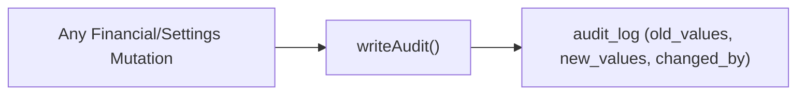

# Module 10: Audit Trail

**Last Verified:** 2026-11-12

1. **Purpose:** Displays an immutable, filterable log of every create, update, approval, and settings change with actor attribution.
2. **Who Uses It:** Owner, Managing Partner, Auditors (`audit.view`, `reports.audit.view`).
3. **Screens & Routes:** `/audit`, `/reports/audit-trail`, `/reports/user-activity`, `/reports/reconciliation`.
4. **Main Workflow:**

5. **Data (Tables Read & Written):** Reads `audit_log` and `control_plane.global_users` (actor names/emails).
6. **Business Rules:** Every financial write must create an `audit_log` row with non-null `changed_by` (`BR-10`).
7. **Calculations:** N/A (append-only event log).
8. **Integrations:** Called inside `$transaction` across expenses, sales, payments, contra transfers, profit distribution, and Fiscal Years.
9. **Code Map:** `src/app/audit/page.tsx`, `src/lib/tenantRules.ts` (`writeAudit`), `src/lib/reports/audit-trail.ts`.
10. **Edge Cases & Validations:** Reconciliation report cross-checks ledger sums against cached balances.
11. **Known Limitations:** Control-plane `audit_logs` are separate from tenant `audit_log`.
