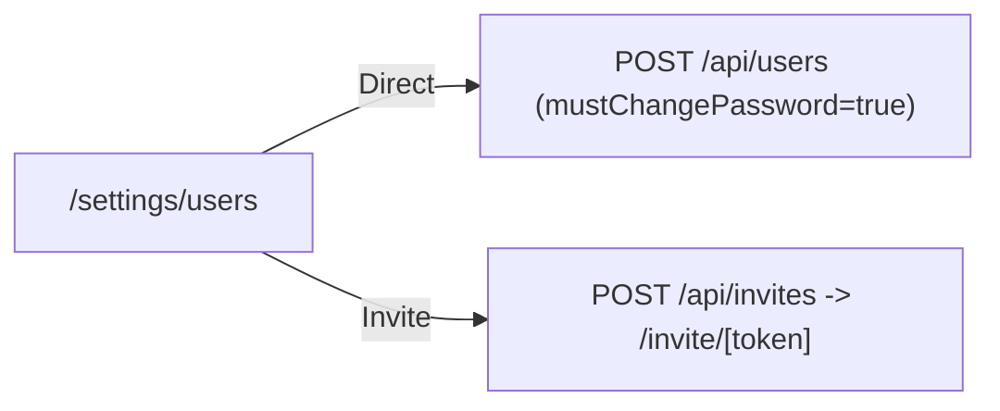

# Module 11: Users & Invitations

**Last Verified:** 2026-11-12

1. **Purpose:** Allows administrators to create staff accounts, send invite tokens, assign roles, reset passwords, and deactivate users.
2. **Who Uses It:** Owner (`users.view`, `users.manage`).
3. **Screens & Routes:** `/settings/users`, `/invite/[token]`.
4. **Main Workflow:**

5. **Data (Tables Read & Written):** Reads/Writes `control_plane.global_users`, `control_plane.user_invitations`, `tenant.user_roles`, `tenant.roles`.
6. **Business Rules:** Self-lockout protection prevents admins from deactivating themselves; deactivated users lose session access immediately.
7. **Calculations:** N/A.
8. **Integrations:** Links `global_users.id` to `tenant.user_roles.user_id`.
9. **Code Map:** `src/app/settings/users/**`, `src/app/api/users/**`, `src/app/api/invites/**`, `src/app/invite/[token]/page.tsx`.
10. **Edge Cases & Validations:** Invite acceptance atomically marks `user_invitations.acceptedAt` and creates `global_users` + `user_roles`.
11. **Known Limitations:** Invite links must be copied/shared manually unless an email sender is configured.
