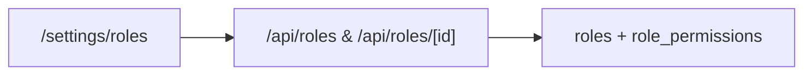

# Module 12: Roles & Permissions

**Last Verified:** 2026-11-12

1. **Purpose:** Manages tenant RBAC roles, permission assignments across 79 keys, and role duplication.
2. **Who Uses It:** Owner (`roles.manage`).
3. **Screens & Routes:** `/settings/roles`.
4. **Main Workflow:**

5. **Data (Tables Read & Written):** Reads/Writes `roles`, `role_permissions`, `user_roles`.
6. **Business Rules:** System `Owner` role cannot be edited or deleted (`BR-14`); changes take effect immediately on next request.
7. **Calculations:** N/A.
8. **Integrations:** Evaluated by `can()` in `src/lib/rbac.ts` across every page, API, and dashboard widget.
9. **Code Map:** `src/app/settings/roles/**`, `src/app/api/roles/**`, `src/lib/permissions.ts`, `src/lib/rbac.ts`, `src/lib/seedRoles.ts`.
10. **Edge Cases & Validations:** Duplicate role endpoint (`/api/roles/[id]/duplicate`) clones permissions into a non-system custom role.
11. **Known Limitations:** Permission keys are code-defined in `src/lib/permissions.ts`.
