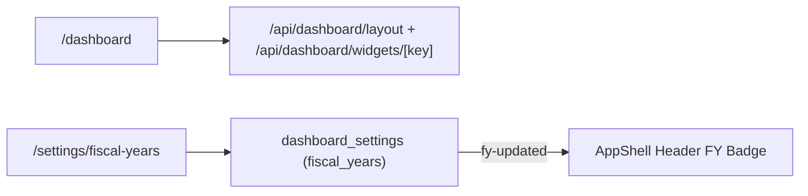

# Module 13: Executive Dashboard & Fiscal Years (FY)

**Last Verified:** 2026-11-12

1. **Purpose:** Renders permission-gated executive KPIs/charts across 6 tabs and lets admins configure Fiscal Years and the active reporting FY.
2. **Who Uses It:** All authenticated staff (`dashboard.view`, `dashboard.tab.*`, `dashboard.widget.*`); FY mutations require `dashboard.settings.manage`, `roles.manage`, or `users.manage`.
3. **Screens & Routes:** `/dashboard`, `/settings/fiscal-years`.
4. **Main Workflow:**

5. **Data (Tables Read & Written):** Reads/Writes `dashboard_layouts`, `dashboard_settings`, `audit_log`.
6. **Business Rules:** Current active FY cannot be deleted (`BR-14`); duplicate FY labels and `endDate < startDate` are rejected with `400`.
7. **Calculations:** **Worked Example:** BD FY `2026-2027` runs `2026-07-01` to `2027-06-30`; switching active FY updates `AppShell` header badge and `preset=this_fy` reports.
8. **Integrations:** Drives `preset=this_fy` date filtering in `/reports/[key]` and `/api/reports/[key]`.
9. **Code Map:** `src/app/dashboard/**`, `src/lib/dashboard/**`, `src/lib/fiscalYear.ts`, `src/app/settings/fiscal-years/**`, `src/app/api/settings/fiscal-years/route.ts`.
10. **Edge Cases & Validations:** If `fiscal_years` has not been customized yet, `getFiscalYears()` returns default BD Jul–Jun current & previous FYs.
11. **Known Limitations:** Widget data queries assume a single active FY badge at a time.
