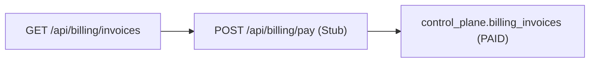

# Module 14: SaaS Billing

**Last Verified:** 2026-11-12

1. **Purpose:** Tracks tenant subscription plans and invoices in the control plane.
2. **Who Uses It:** Owner (`billing.manage`).
3. **Screens & Routes:** `/settings/billing`.
4. **Main Workflow:**

5. **Data (Tables Read & Written):** Reads/Writes `control_plane.billing_invoices`, `control_plane.subscription_plans`, `control_plane.tenants`.
6. **Business Rules:** Restricted to `billing.manage` (Owner role).
7. **Calculations:** Plan price in BDT (`subscription_plans.price_bdt`) per billing cycle.
8. **Integrations:** Reads `tenantId` from session JWT.
9. **Code Map:** `src/app/settings/billing/**`, `src/app/api/billing/invoices/route.ts`, `src/app/api/billing/pay/route.ts`.
10. **Edge Cases & Validations:** Non-owners receive `403 Forbidden`.
11. **Known Limitations:** **Stubbed:** `/api/billing/pay` simulates payment without a live bKash/SSLCommerz/Stripe gateway.
