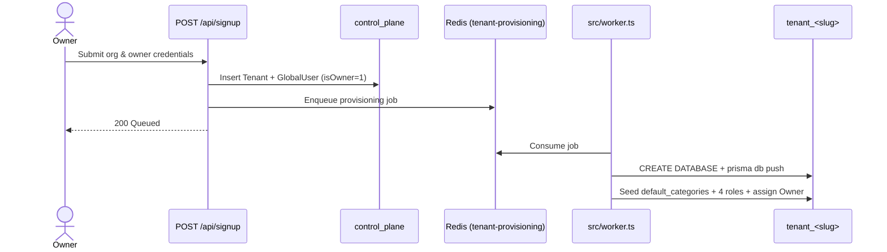
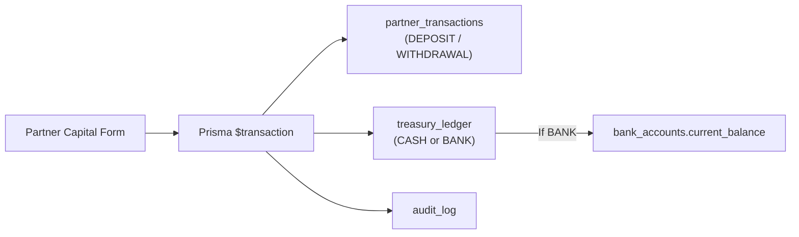
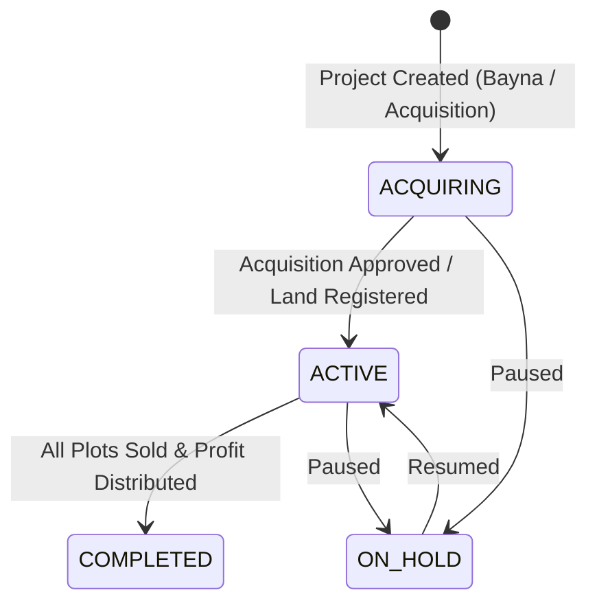
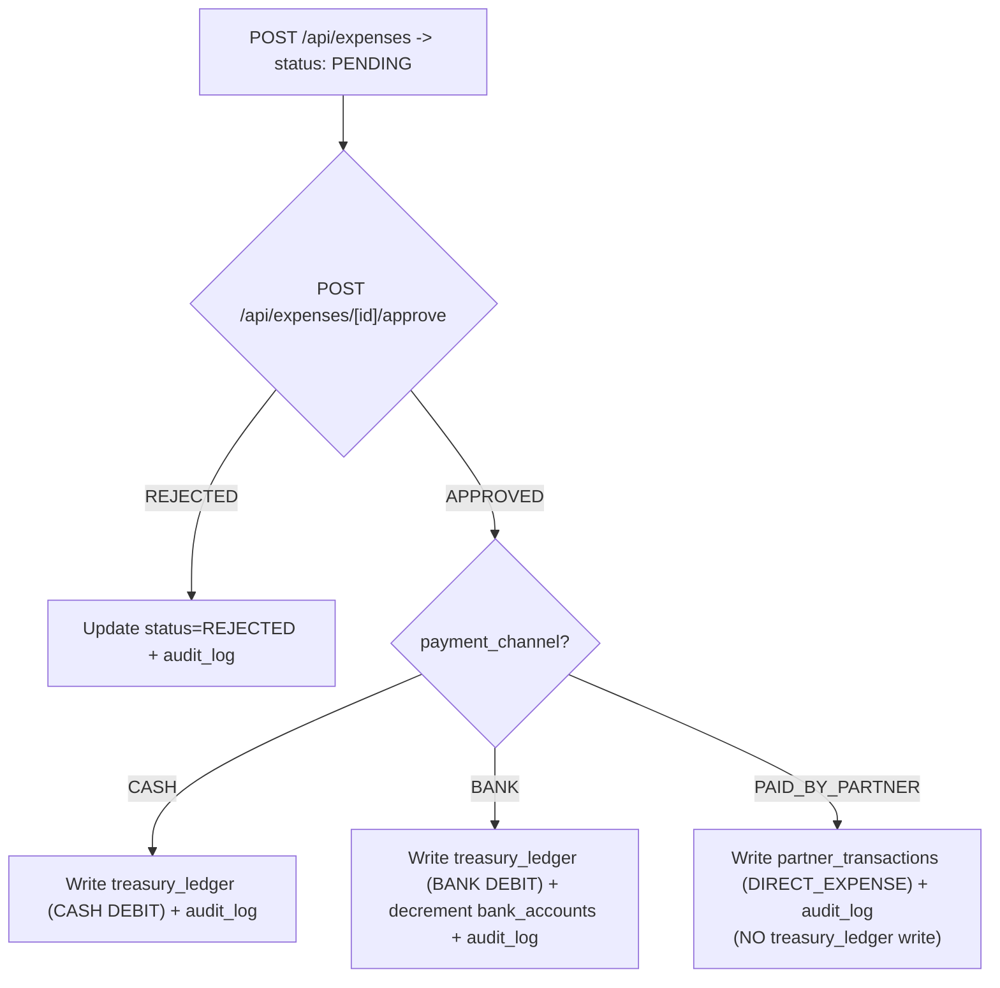
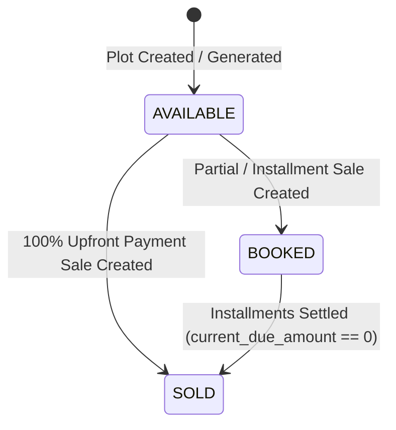
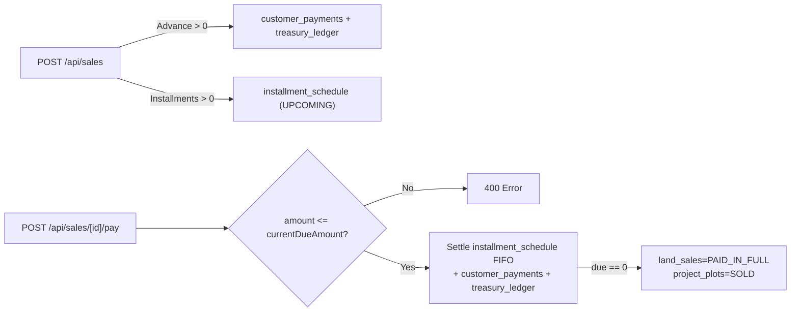
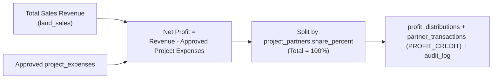

# 06. End-to-End Business Workflows

**Purpose:** Step-by-step explanations and Mermaid diagrams for all core LandInvest workflows.  
**Intended Reader:** Business Owner, Technical Lead, QA Engineer, New Developer.  
**Last Verified:** 2026-11-12

---

## 1. Tenant Signup & Provisioning

1. User submits organization name, email, and password at `/signup` (`POST /api/signup`).
2. API creates a `tenants` row (`status = "trial"`, unique `db_name`) and `global_users` row (`isOwner = true`), then enqueues a job on BullMQ queue `tenant-provisioning`.
3. `src/worker.ts` picks up the job, runs `CREATE DATABASE`, pushes `prisma/tenant/schema.prisma`, seeds `default_categories`, seeds 4 default roles, and assigns `Owner` to the signup user.

---

## 2. Login, Session & Tenant Resolution

1. User submits email + password at `/login` (`next-auth` CredentialsProvider).
2. `src/auth.ts` verifies `global_users.passwordHash` (`bcryptjs`), `isActive === true`, and `tenant.status` in `["active", "trial"]`.
3. JWT stores `tenantId`, `user_id`, `isOwner`, `dbName`. Subsequent requests call `getTenantClientFromSession()` to resolve the cached `PrismaClient` for that tenant.

---

## 3. User Invitation & Direct Creation

- **Direct Creation:** Admin creates user via `POST /api/users` with role + temporary password (`mustChangePassword = true`).
- **Invitation:** Admin sends invite via `POST /api/invites` creating a `user_invitations` token; invitee accepts at `/invite/[token]`.

---

## 4. Capital Pooling (Partner Deposit / Withdrawal)

1. Manager/Owner records a deposit or withdrawal on `/partners/capital`.
2. Within `$transaction`: writes `partner_transactions`, writes `treasury_ledger` (`CASH` or `BANK`), updates `bank_accounts.current_balance` if `BANK`, and records `audit_log`.

---

## 5. Land Acquisition & 6. Project Lifecycle State Machine

1. User completes the Land Acquisition wizard (`/projects/new`): project details, Mouza/JL/Dag/Khatian metadata, partner share % (must sum to 100%), and optional placeholder plot generation.
2. Project transitions across lifecycle states:

---

## 7. Expense Voucher Approval & Three Payment Channels

1. User creates an expense (`POST /api/expenses`) -> status `PENDING` + `audit_log`.
2. Approver clicks Approve/Reject (`POST /api/expenses/[id]/approve`):
   - **CASH:** Writes `treasury_ledger` (`CASH`, `DEBIT`).
   - **BANK:** Writes `treasury_ledger` (`BANK`, `DEBIT`) and decrements `bank_accounts.current_balance`.
   - **PAID_BY_PARTNER:** Never touches `treasury_ledger`; writes `partner_transactions` (`DIRECT_EXPENSE`)!

---

## 8. Plot Status State Machine

---

## 9. Plot Sale, Installments & Collections

1. Sale created via `POST /api/sales` (single plot, multi-plot `plot_ids`, or `is_whole_project`). Validates `advance <= total_agreed_price`.
2. Creates `land_sales` (`PAID_IN_FULL`, `PARTIAL`, or `BOOKED`), updates `project_plots` (`SOLD` or `BOOKED`), generates `installment_schedule` rows, and records advance in `customer_payments` + `treasury_ledger`.
3. Subsequent payments (`POST /api/sales/[id]/pay` via `collectPayment()` in `src/lib/collections.ts`) validate `amount <= currentDueAmount`, settle `installment_schedule` rows **FIFO**, update `land_sales.status` to `PAID_IN_FULL` and plots to `SOLD` when due reaches `0`.

---

## 10. Contra Transfer (Cash ↔ Bank)

- **Accountant** (`POST /api/treasury/contra` without `treasury.contra.approve`): creates a `PENDING` `treasury_transfer_requests` row.
- **Owner / Managing Partner** (`POST /api/treasury/contra/[id]/approve` or direct creation): writes paired `DEBIT` and `CREDIT` rows in `treasury_ledger`, updates `bank_accounts.current_balance`, and records `audit_log`.

---

## 11. Profit Calculation & Distribution

---

## 12. Report Generation & Export

1. User opens `/reports` (filterable by category and switchable between Grid/List view).
2. Opens `/reports/[key]`, selects preset (including `this_fy` which resolves the tenant's active Fiscal Year from `dashboard_settings`) or custom dates.
3. Exports via `/api/reports/[key]?format=pdf|excel` using Puppeteer (PDF) or HTML table (Excel).

---

## 13. Role & Permission Changes

1. Admin edits role permissions in `/settings/roles` (`PATCH /api/roles/[id]`).
2. Because `can()` queries `user_roles -> role_permissions` from the tenant DB on each request, permission changes take effect **immediately** without requiring user re-login.

---

## 14. Tenant Backup, Restore & Migration Rollout

- **Backup:** `mysqldump` of `control_plane` + each `tenant_*` database.
- **Restore:** `mysql < backup.sql` into target DB.
- **Schema Rollout:** Iterate over all active `tenants.db_name` rows in `control_plane` and execute `prisma db push --schema=prisma/tenant/schema.prisma` with `DATABASE_URL_TENANT` set per tenant.
`;
writeDoc("06-workflows.md", ...)`
