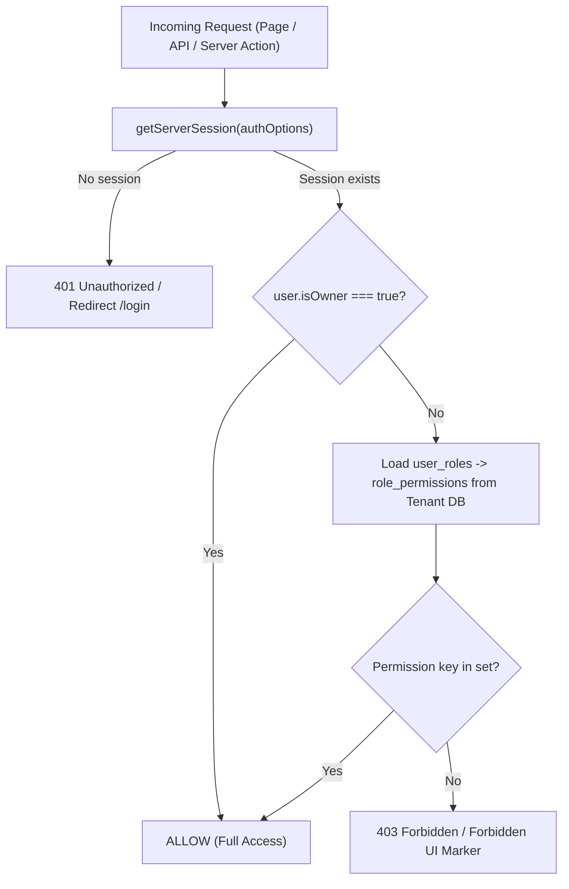

# 07. Authentication, Roles & Permissions

**Purpose:** Documents authentication, JWT sessions, tenant resolution, all 79 permission keys, default roles, and RBAC safety rules.  
**Intended Reader:** Security Reviewer, Technical Lead, Developer, Admin Owner.  
**Last Verified:** 2026-11-12

---

## Authentication & Session Architecture

- **Provider:** Auth.js v4 (`next-auth`) with `CredentialsProvider` (`src/auth.ts`).
- **Passwords:** Hashed with `bcryptjs`. Users invited or created with temporary passwords have `mustChangePassword = true`, enforced by `AppShell.tsx` redirecting to `/change-password`.
- **Session Strategy:** Stateless JWT enriched with `user_id`, `tenantId`, `isOwner`, `mustChangePassword`, `fullName`, and `dbName`.
- **Live Revocation Check:** On every `session()` callback, `src/auth.ts` queries `control_plane.global_users` and `tenants.status`. Deactivated users or suspended/cancelled tenants receive `null` session (fail-closed).
- **Rate Limiting:** Configurable via `AUTH_RATE_LIMIT_MAX` (Redis / in-memory login throttling).

---

## Permission Evaluation Flow

---

## Default Roles (`src/lib/seedRoles.ts`)

| Role Name | System Role | Permission Count | Description |
|---|---|---:|---|
| **Owner** | Yes (Protected) | 79 | Full access — cannot be edited or deleted |
| **Managing Partner** | No | 76 | Executive access across all operations, financial ledgers, and reporting |
| **Accountant** | No | 27 | Treasury ledger, cash & bank management, payment collection, and expense accounting |
| **Site Manager** | No | 20 | Land projects inspection, plots management, and on-site project expense entries |

---

## Role vs Module Permission Matrix (Base Permissions)

| Permission Key | Owner | Managing Partner | Accountant | Site Manager |
|---|---|---|---|---|
| `dashboard.view` | YES | YES | YES | YES |
| `dashboard.customize` | YES | YES | YES | YES |
| `dashboard.layout.manage` | YES | YES | - | - |
| `dashboard.export` | YES | YES | YES | - |
| `dashboard.settings.manage` | YES | YES | - | - |
| `partners.view` | YES | YES | - | - |
| `partners.manage` | YES | YES | - | - |
| `partners.capital.deposit` | YES | YES | - | - |
| `partners.capital.withdraw` | YES | YES | - | - |
| `partners.ledger.view` | YES | YES | - | - |
| `treasury.view` | YES | YES | YES | - |
| `treasury.bank.manage` | YES | YES | YES | - |
| `treasury.contra.create` | YES | YES | YES | - |
| `treasury.contra.approve` | YES | YES | - | - |
| `projects.view` | YES | YES | - | YES |
| `projects.create` | YES | YES | - | - |
| `projects.edit` | YES | YES | - | - |
| `projects.delete` | YES | YES | - | - |
| `plots.manage` | YES | YES | - | YES |
| `expenses.view` | YES | YES | YES | YES |
| `expenses.create` | YES | YES | YES | YES |
| `expenses.approve` | YES | YES | - | - |
| `expenses.delete` | YES | YES | - | - |
| `sales.view` | YES | YES | YES | - |
| `sales.create` | YES | YES | - | - |
| `sales.collect` | YES | YES | YES | - |
| `receipts.print` | YES | YES | YES | - |
| `profit.view` | YES | YES | - | - |
| `profit.distribute` | YES | YES | - | - |
| `reports.view` | YES | YES | YES | YES |
| `reports.export` | YES | YES | - | - |
| `reports.financial.view` | YES | YES | YES | - |
| `reports.partners.view` | YES | YES | - | - |
| `reports.projects.view` | YES | YES | - | YES |
| `reports.sales.view` | YES | YES | - | - |
| `reports.audit.view` | YES | YES | - | - |
| `users.view` | YES | YES | - | - |
| `users.manage` | YES | - | - | - |
| `roles.manage` | YES | - | - | - |
| `billing.manage` | YES | - | - | - |
| `audit.view` | YES | YES | - | - |

---

## Complete Permission Catalog (79 Keys across 9 Groups)

| Permission Key | Module | English Label | Bengali Label |
|---|---|---|---|
| `dashboard.view` | Dashboard & Executive Views | View dashboard | ড্যাশবোর্ড দেখুন |
| `dashboard.customize` | Dashboard & Executive Views | Customize own dashboard layout | নিজের ড্যাশবোর্ড কাস্টমাইজ করুন |
| `dashboard.layout.manage` | Dashboard & Executive Views | Manage role default layouts | রোলের ডিফল্ট লেআউট পরিচালনা করুন |
| `dashboard.export` | Dashboard & Executive Views | Export dashboard as PDF/PNG | ড্যাশবোর্ড এক্সপোর্ট (পিডিএফ/ছবি) |
| `dashboard.settings.manage` | Dashboard & Executive Views | Manage dashboard settings & thresholds | ড্যাশবোর্ড সেটিংস ও থ্রেশহোল্ড পরিচালনা |
| `dashboard.tab.overview` | Dashboard & Executive Views | View Tab: Executive Overview | ট্যাব দেখুন: এক্সিকিউটিভ ওভারভিউ |
| `dashboard.tab.financial` | Dashboard & Executive Views | View Tab: Treasury & Financials | ট্যাব দেখুন: ট্রেজারি ও আর্থিক অবস্থা |
| `dashboard.tab.projects` | Dashboard & Executive Views | View Tab: Projects & Land | ট্যাব দেখুন: প্রকল্প ও জমি |
| `dashboard.tab.sales` | Dashboard & Executive Views | View Tab: Sales & Collections | ট্যাব দেখুন: বিক্রয় ও আদায় |
| `dashboard.tab.partners` | Dashboard & Executive Views | View Tab: Partners & Capital | ট্যাব দেখুন: অংশীদার ও মূলধন |
| `dashboard.tab.operations` | Dashboard & Executive Views | View Tab: Operations & Approvals | ট্যাব দেখুন: অপারেশনস ও অনুমোদন |
| `dashboard.widget.cash_balance` | Dashboard & Executive Views | Widget: Cash in Hand | উইজেট: হাতে নগদ |
| `dashboard.widget.bank_balance` | Dashboard & Executive Views | Widget: Total Bank Balance | উইজেট: মোট ব্যাংক ব্যালেন্স |
| `dashboard.widget.total_liquidity` | Dashboard & Executive Views | Widget: Total Liquidity | উইজেট: মোট তারল্য |
| `dashboard.widget.working_capital` | Dashboard & Executive Views | Widget: Available Working Capital | উইজেট: কার্যনির্বাহী মূলধন |
| `dashboard.widget.partner_equity` | Dashboard & Executive Views | Widget: Partner Equity Injected | উইজেট: অংশীদার মূলধন বিনিয়োগ |
| `dashboard.widget.capital_deployed` | Dashboard & Executive Views | Widget: Capital Deployed in Land | উইজেট: প্রকল্পে নিয়োজিত মূলধন |
| `dashboard.widget.unsold_inventory` | Dashboard & Executive Views | Widget: Unsold Inventory Value | উইজেট: অবিক্রীত ইনভেন্টরি মূল্য |
| `dashboard.widget.total_receivables` | Dashboard & Executive Views | Widget: Total Receivables | উইজেট: মোট বকেয়া/প্রাপ্য |
| `dashboard.widget.overdue_receivables` | Dashboard & Executive Views | Widget: Overdue Receivables | উইজেট: মেয়াদোত্তীর্ণ বকেয়া |
| `dashboard.widget.sales_month` | Dashboard & Executive Views | Widget: Sales This Month | উইজেট: চলতি মাসের বিক্রয় |
| `dashboard.widget.collections_month` | Dashboard & Executive Views | Widget: Collections This Month | উইজেট: চলতি মাসের নগদ আদায় |
| `dashboard.widget.expenses_month` | Dashboard & Executive Views | Widget: Expenses This Month | উইজেট: চলতি মাসের খরচ |
| `dashboard.widget.pending_approvals` | Dashboard & Executive Views | Widget: Pending Approvals | উইজেট: অনুমোদনাধীন ভাউচার |
| `dashboard.widget.net_profit` | Dashboard & Executive Views | Widget: Net Profit & Realized Cash | উইজেট: নিট মুনাফা ও বাস্তবায়িত লাভ |
| `dashboard.widget.portfolio_roi` | Dashboard & Executive Views | Widget: Portfolio ROI % | উইজেট: পোর্টফোলিও আরওআই % |
| `dashboard.widget.cash_flow_trend` | Dashboard & Executive Views | Widget: 12-Month Cash Flow Trend | উইজেট: ১২ মাসের ক্যাশ ফ্লো ট্রেন্ড |
| `dashboard.widget.project_cost_vs_sales` | Dashboard & Executive Views | Widget: Project Cost vs Sales vs Collected | উইজেট: প্রকল্প খরচ বনাম বিক্রয় বনাম আদায় |
| `dashboard.widget.project_cost_share` | Dashboard & Executive Views | Widget: Project-wise Cost Share | উইজেট: প্রকল্পভিত্তিক খরচ বণ্টন |
| `dashboard.widget.expense_breakdown` | Dashboard & Executive Views | Widget: Expense Breakdown by Category | উইজেট: খাতভিত্তিক ব্যয়ের বিভাজন |
| `dashboard.widget.receivables_aging` | Dashboard & Executive Views | Widget: Receivables Aging | উইজেট: বকেয়া এইজিং বিশ্লেষণ |
| `dashboard.widget.plot_inventory_status` | Dashboard & Executive Views | Widget: Plot Inventory Status | উইজেট: প্লট ইনভেন্টরি অবস্থা |
| `dashboard.widget.partner_equity_dist` | Dashboard & Executive Views | Widget: Partner Equity Distribution | উইজেট: অংশীদারদের মূলধন বণ্টন |
| `dashboard.widget.profit_by_project` | Dashboard & Executive Views | Widget: Profit by Project | উইজেট: প্রকল্পভিত্তিক নিট মুনাফা |
| `dashboard.widget.collection_trend` | Dashboard & Executive Views | Widget: Collection Trend vs Scheduled Dues | উইজেট: আদায় ট্রেন্ড বনাম নির্ধারিত বকেয়া |
| `dashboard.widget.cash_flow_forecast` | Dashboard & Executive Views | Widget: 90-Day Cash Flow Forecast | উইজেট: ৯০ দিনের ক্যাশ ফ্লো পূর্বাভাস |
| `dashboard.widget.recent_transactions` | Dashboard & Executive Views | Widget: Recent Treasury Transactions | উইজেট: সাম্প্রতিক ট্রেজারি লেনদেন |
| `dashboard.widget.overdue_installments` | Dashboard & Executive Views | Widget: Overdue Installments List | উইজেট: মেয়াদোত্তীর্ণ কিস্তির তালিকা |
| `dashboard.widget.project_summary` | Dashboard & Executive Views | Widget: Projects Summary Table | উইজেট: প্রকল্পের সংক্ষিপ্ত বিবরণী |
| `dashboard.widget.partner_summary` | Dashboard & Executive Views | Widget: Partners Capital & Balance | উইজেট: অংশীদারদের মূলধন ও বর্তমান স্থিতি |
| `dashboard.widget.pending_vouchers` | Dashboard & Executive Views | Widget: Pending Expense Vouchers | উইজেট: অনুমোদনাধীন ব্যয়ের তালিকা |
| `dashboard.widget.quick_actions` | Dashboard & Executive Views | Widget: Quick Actions | উইজেট: দ্রুত অ্যাকশন |
| `dashboard.widget.active_alerts` | Dashboard & Executive Views | Widget: Smart Insights & Alerts | উইজেট: স্মার্ট ইনসাইট ও সতর্কবার্তা |
| `partners.view` | Partners | View partners | পার্টনার দেখুন |
| `partners.manage` | Partners | Manage partners | পার্টনার ব্যবস্থাপনা |
| `partners.capital.deposit` | Partners | Record capital deposit | মূলধন জমা |
| `partners.capital.withdraw` | Partners | Record capital withdrawal | মূলধন উত্তোলন |
| `partners.ledger.view` | Partners | View partner ledger | পার্টনার লেজার দেখুন |
| `treasury.view` | Treasury | View treasury | ট্রেজারি দেখুন |
| `treasury.bank.manage` | Treasury | Manage bank accounts | ব্যাংক অ্যাকাউন্ট ব্যবস্থাপনা |
| `treasury.contra.create` | Treasury | Create contra transfer | কন্ট্রা তৈরি |
| `treasury.contra.approve` | Treasury | Approve contra transfer | কন্ট্রা অনুমোদন |
| `projects.view` | Land Projects | View projects | প্রকল্প দেখুন |
| `projects.create` | Land Projects | Create project | প্রকল্প তৈরি |
| `projects.edit` | Land Projects | Edit project | প্রকল্প সম্পাদনা |
| `projects.delete` | Land Projects | Delete project / plot | প্রকল্প/প্লট মুছুন |
| `plots.manage` | Land Projects | Manage plots | প্লট ব্যবস্থাপনা |
| `expenses.view` | Expenses | View expenses | ব্যয় দেখুন |
| `expenses.create` | Expenses | Create expense | ব্যয় তৈরি |
| `expenses.approve` | Expenses | Approve expense | ব্যয় অনুমোদন |
| `expenses.delete` | Expenses | Delete expense | ব্যয় মুছুন |
| `sales.view` | Sales | View sales | বিক্রয় দেখুন |
| `sales.create` | Sales | Create sale / booking | বিক্রয় তৈরি |
| `sales.collect` | Sales | Collect payment | পেমেন্ট আদায় |
| `receipts.print` | Sales | Print receipts | রসিদ প্রিন্ট |
| `profit.view` | Profit | View PnL | লাভ-ক্ষতি দেখুন |
| `profit.distribute` | Profit | Distribute profit | লাভ বণ্টন |
| `reports.view` | Reports | View reports | রিপোর্ট দেখুন |
| `reports.export` | Reports | Export reports | রিপোর্ট এক্সপোর্ট |
| `reports.financial.view` | Reports | View financial reports | আর্থিক প্রতিবেদন দেখুন |
| `reports.partners.view` | Reports | View partner reports | অংশীদার প্রতিবেদন দেখুন |
| `reports.projects.view` | Reports | View project reports | প্রকল্প প্রতিবেদন দেখুন |
| `reports.sales.view` | Reports | View sales reports | বিক্রয় প্রতিবেদন দেখুন |
| `reports.audit.view` | Reports | View audit reports | অডিট প্রতিবেদন দেখুন |
| `users.view` | Administration | View users | ইউজার দেখুন |
| `users.manage` | Administration | Manage users | ইউজার ব্যবস্থাপনা |
| `roles.manage` | Administration | Manage roles | রোল ব্যবস্থাপনা |
| `billing.manage` | Administration | Manage billing | বিলিং ব্যবস্থাপনা |
| `audit.view` | Administration | View audit log | অডিট লগ দেখুন |

---

## RBAC Safety Rules

1. **Owner Protection:** The `Owner` role (`isSystem: true`) cannot be edited or deleted via `/api/roles/[id]`.
2. **Privilege Escalation Prevention:** Non-owners cannot grant permissions they do not hold or assign the `Owner` role.
3. **Self-Lockout Prevention:** Users cannot deactivate themselves or strip `users.manage` / `roles.manage` from their own active role.
